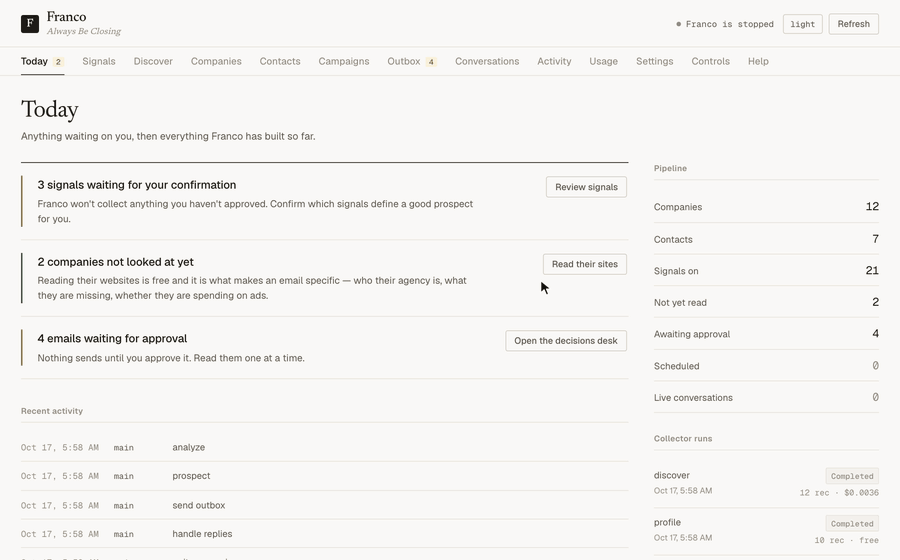

# Franco

**An outbound sales agent that runs on your own machine, on the Claude Code or Codex subscription you already pay for.**

Franco works through a list of accounts. For each one it finds or imports a reason to write, sends a short email sequence from your own mailbox, reads the replies, and handles them. Every fact it uses is recorded with its source. You review every email before it sends, unless you turn on autopilot.

It works in two ways:

- **Generated outreach.** Franco finds businesses, reads their websites, picks the right person, and drafts a personalized sequence with the model.
- **Approved-copy outreach.** You import accounts you researched yourself, with one sourced observation for each. Franco sends your approved sequences word for word: no model writes them, the schedule counts business days, and the compliance footer and suppression rules are enforced in code. This is the mode Gortex uses.

There is no model API bill. Model calls go through `claude` (Claude Pro or Max) or, if you opt in, an isolated `codex` runtime (a ChatGPT plan). Everything that can be done in plain code is done in plain code.



<sub>Recorded from made-up demo data by `scripts/record_demo.py`. Re-run it after changing the dashboard.</sub>

---

## Contents

- [Quick start](#quick-start)
- [How Franco works](#how-franco-works)
- [Approved-copy outreach](#approved-copy-outreach)
- [Generated outreach](#generated-outreach)
- [Review, autopilot and the kill switch](#review-autopilot-and-the-kill-switch)
- [Replies](#replies)
- [The dashboard](#the-dashboard)
- [Configuration](#configuration)
- [Commands](#commands)
- [Using a ChatGPT plan (Codex)](#using-a-chatgpt-plan-codex)
- [Compliance and deliverability](#compliance-and-deliverability)
- [Data](#data)
- [Troubleshooting](#troubleshooting)
- [Development](#development)
- [License](#license)
- [Contact](#contact)

---

## Quick start

**You need:**
- Python 3.11 or newer. macOS ships 3.9, so use `brew install python@3.13`.
- Claude Code, logged in with `claude login`, on a Pro or Max plan. Codex is the alternative; see [below](#using-a-chatgpt-plan-codex).
- A mailbox to send from. Google Workspace is recommended.

```bash
git clone https://github.com/GortexAI/franco.git && cd franco
python3.13 -m venv .venv && source .venv/bin/activate && pip install -e .

cp .env.example .env && $EDITOR .env   # mail provider + verifier keys, documented inline
franco gmail auth                      # one-time browser login when provider: gmail
franco gmail test

franco dashboard                       # http://localhost:5555
franco run                             # the heartbeat loop
```

Or open the repo in Claude Code and say **"set up Franco for me"**. `CLAUDE.md` turns Claude into the setup guide: it checks what's missing and asks for one thing at a time.

Put your real settings in `franco.local.yaml`. It is gitignored, and when it exists it is used instead of `franco.yaml`. The tracked `franco.yaml` stays a template.

---

## How Franco works

Franco runs a heartbeat. By default, every 15 minutes it wakes up, checks quiet hours and its usage budget, decides what most needs doing, does it, logs it, and goes back to sleep.

```
handle replies  >  send due email  >  write/stage sequences  >  prospect  >  idle (analyze)
```

The decision is made from counts in the database, not by asking a model. Profiling and draining the outbox happen on every cycle because they cost nothing.

| Agent | What it does |
|---|---|
| **Scout** | Scores and personalizes prospects. Searching, website reading and email resolution are plain Python. |
| **Writer** | Drafts sequences with the model (generated mode), or renders approved copy with no model (approved-copy mode). |
| **Sender** | Stages each email in the outbox with a send time, then sends due, approved items with human-like pacing, the daily cap and the pre-send gate. |
| **Handler** | Reads replies, removes quoted text, classifies intent, stops sequences, records opt-outs, detects bounces, and queues responses through the outbox. |
| **Analyst** | On idle cycles, writes pipeline stats to `data/analytics.json`. |

---

## Approved-copy outreach

Use this mode when the copy has been signed off and must go out exactly as written.

### 1. Define the sequences

In `franco.local.yaml`:

```yaml
outreach:
  mode: templates
  timezone: America/Los_Angeles
  send_hour: 9
  observation_max_age_days: 90
  campaigns:
    M1:
      name: Vertical marketplaces
      steps:
        - day: 1
          subject: "{{company}} sponsored listings"
          body: |
            Hi {{first_name}},

            I noticed {{verified_observation}}.
            ...
            Hemin
        - { day: 5,  subject: "...", body: "..." }
        - { day: 9,  subject: "...", body: "..." }
        - { day: 14, subject: "...", body: "..." }

compliance:
  require_footer: true
  postal_address: "<your postal address>"
  blocked_claims: ["real-time auction", "guaranteed uplift"]
  send_opt_out_ack: true
```

The only merge fields are `{{first_name}}`, `{{last_name}}`, `{{company}}`, `{{title}}`, `{{verified_observation}}` and `{{sender_name}}`. If any field can't be filled, the account is skipped. Franco never sends a gap or a guess.

`day` counts business days. Day 1 is the first send, and each later step is scheduled from the date the previous step actually went out.

### 2. Import researched accounts

Each row is one account, one buyer, the campaign they get, and the fact that justifies writing to them, with the page it came from and the date it was checked.

```bash
franco import --template > accounts.csv   # header + example row
franco import accounts.csv --dry-run      # validate every row, write nothing
franco import accounts.csv --verify --owner Hemin
```

Required columns: `company, domain, campaign, first_name, last_name, title, email, observation, source_url, source_date`. Optional columns: `owner, segment, hypothesis, score (0-10), email_status, linkedin_url`. Common spreadsheet header names are accepted as aliases.

A row is rejected if it:
- is missing a field;
- names a campaign that isn't configured;
- has a bad email, a source that isn't a link, or a future date;
- is on the suppression list;
- belongs to a different owner;
- is for someone who is already in outreach.

The observation is stored as the account's `TRIGGER_OBSERVATION`, together with its source and date.

### 3. What happens next

On the next cycle, the writer stages the full sequence for one contact per account. It does this only when:
- the email is verified;
- no one else at the company is already in outreach;
- the observation is within `observation_max_age_days`.

Every step waits in the outbox for review, unless autopilot is on.

- **Every** email, replies included, is checked by the pre-send gate for blocked claims.
- **Cold** emails must also carry the footer, and they get List-Unsubscribe headers.
- **No** cold email is sent while the postal address is blank.

`franco outbox` lists each draft with the reason for writing: the campaign, the observation, its source and the date it was checked. `franco outbox --edit <id>` opens a draft in `$EDITOR`.

---

## Generated outreach

This is the default mode, `outreach.mode: generated`.

**1. Learn the product.** `franco train https://your-site.com` writes `franco.yaml`, `skills/product_knowledge.md` and `skills/competitive_intel.md`. The two skills files are gitignored.

**2. Confirm signals.** Franco proposes a catalog of 24 signals it knows how to collect, such as ad pixels, tech stack, open roles, incumbent agency and search rank. It collects nothing until you confirm signals:

```bash
franco signals                     # the catalog, with what each one costs
franco signals --confirm free      # everything that costs nothing
franco signals --confirm SERP_RANK # a paid one, explicitly
```

The cohort builder on the dashboard's Signals tab turns confirmed signals into a target list. You choose what a prospect must have and what disqualifies it, and it counts the matches as you go.

**3. Discover.** Discovery is the only stage that spends money, so it always estimates first:

```bash
franco discover --providers        # the menu, with real prices
franco discover --estimate
franco discover --provider dataforseo_listings --max-spend 2.00
```

| Source | Cost | Free tier |
|---|---|---|
| OpenStreetMap (default) | free | unlimited. Thin coverage; a trial source. |
| DataForSEO Business Listings | $0.372 / 1k businesses | $1 credit |
| DataForSEO SERP | $0.0018 / search at depth 30 | $1 credit + sandbox |
| Serper | ~$0.30–1.00 / 1k | 2,500 free |

**4. Profile, enrich, verify.** Franco reads each homepage, `robots.txt`, `sitemap.xml`, and the team and careers pages, with no model calls. It learns each company's email pattern and verifies one candidate through Reoon, ZeroBounce or Hunter. Every address is tagged `verified`, `risky` (catch-all), `guess` or `invalid`, and Franco only sends to deliverable addresses. Without a verifier key, addresses stay `guess` and are never sent to.

**5. Write.** The writer drafts sequences using the skills in `skills/`, which are plain Markdown you can edit. The next heartbeat uses your changes.

`franco export` writes a sequencer-ready CSV, so Franco is useful as a list builder even if it never sends.

---

## Review, autopilot and the kill switch

By default **every outgoing email waits in the outbox for your approval.** That includes replies.

```bash
franco outbox                   # review in the terminal (with the reason for each draft)
franco outbox --approve <id>    # or --approve-all, --reject <id>, --edit <id>
```

On the dashboard, the Outbox is a decisions desk. One email fills the pane and you work the queue with `A` (approve), `R` (reject) and `J`/`K` (move).

**Autopilot** turns review off without editing config or restarting:

```bash
franco autopilot on              # new emails and replies send on schedule, unreviewed;
                                 # also approves what's already waiting (--keep-pending to skip)
franco autopilot off             # every new draft waits for you again
franco autopilot default         # follow channels.email.require_approval in the config
franco autopilot                 # current state and where it comes from
```

The same switch is on the dashboard's Outbox tab. Autopilot only removes the human review step. Everything else still applies:
- the pre-send gate;
- the footer and blocked-claims checks;
- suppression;
- the account-level stop;
- step ordering;
- the daily cap and quiet hours;
- the bounce kill switch.

Turning autopilot off doesn't affect emails that are already approved. To stop them, use the kill switch.

**Kill switch:** `franco sending pause` (or the Outbox button) stops all outbound immediately. `franco sending resume` restarts it and resets the bounce counter.

**The pre-send gate** is plain code with no model. It rejects an email that has:
- unrendered merge tags, banned phrases or blocked claims;
- a body over the length cap, too many links, or an HTML body;
- a missing footer (cold emails only);
- a recipient that isn't deliverable or doesn't match the database.

---

## Replies

The handler polls the mailbox every cycle.

- Before any rule runs, it removes quoted history and Franco's own footer. A "no thanks" in your own quoted footer never counts as an opt-out.
- **Out-of-office** replies don't stop the sequence.
- **Any other reply** stops the sequence for that contact and cancels queued email to everyone else at the same company.
- **Opt-outs** ("no thanks", "unsubscribe", "stop", and so on, in the body or the subject) add the address to the suppression list. If `send_opt_out_ack` is set, Franco sends a one-line acknowledgement after the suppression is recorded.
- **"Later"** pauses the contact and records when to get back in touch.
- **Bounces** mark the address invalid and cancel its queued sends. If the bounce rate passes `max_bounce_rate`, Franco trips the kill switch.
- **Other intents** get a drafted response, which goes through the outbox like everything else. `outreach.reply_templates` gives the handler approved wording to adapt for each intent.

The suppression list is shared by every campaign:

```bash
franco suppress list
franco suppress add jane@acme.com acme.com --reason "asked to stop"
franco suppress import do_not_contact.csv
franco suppress export > suppressions.csv
```

---

## The dashboard

`franco dashboard` serves a local web UI at `localhost:5555`. It's plain HTML, CSS and JavaScript in `franco/web/`, with no build step: edit a file and reload.

- **Today**: anything waiting on a decision, then the pipeline
- **Signals**: the confirmation gate and the cohort builder
- **Discover**: providers and prices side by side, an estimate, then a run
- **Companies / Contacts**: everything found, with CSV export
- **Campaigns, Outbox, Conversations, Activity**
- **Usage**: quota gauges and token counts for each agent
- **Settings**

---

## Configuration

**`.env`**: credentials. Each variable is documented inline in `.env.example`. You need a mail provider (Gmail OAuth, SMTP+IMAP, or legacy Instantly). A verifier key is strongly recommended.

**`franco.yaml` / `franco.local.yaml`**:

```yaml
persona:     { name, company, role, email, tone }
product:     { name, description, pricing, key_benefits, objection_responses, offer }
icp:         { industries, titles, company_size, geography, hiring_signals, geo_coordinates }
channels:
  email:     { provider: gmail | smtp | instantly, max_daily_sends, require_approval,
               send_to_risky, max_bounce_rate }
  linkedin:  { enabled }
outreach:    { mode: generated | templates, campaigns, timezone, send_hour,
               observation_max_age_days, reply_templates }
compliance:  { require_footer, postal_address, footer, unsubscribe_url,
               blocked_claims, send_opt_out_ack, opt_out_ack }
usage:       { max_daily_claude_percent, heartbeat_interval_minutes, quiet_hours }
brain:       { provider: claude | codex, model, reasoning_effort }
```

`usage.max_daily_claude_percent` caps whichever subscription `brain.provider` uses. Franco reads the live quota and leaves room for your own work.

---

## Commands

```bash
franco run                      # heartbeat loop
franco dashboard                # web UI at localhost:5555
franco setup                    # interactive setup wizard
franco train <url>              # learn a product from its website
franco status [--check]         # pipeline summary / provider health check
franco usage                    # quota + per-agent tokens

franco import FILE              # researched accounts for approved copy (--dry-run, --verify, --template)
franco signals                  # review/confirm signals
franco discover                 # find businesses (--providers, --estimate, --provider, --max-spend)
franco profile                  # read discovered sites (free)
franco export [--all]           # prospects → CSV

franco outbox                   # review queue (--approve, --approve-all, --reject, --edit)
franco autopilot on|off|default # send without review
franco sending pause|resume     # kill switch
franco suppress list|add|remove|import|export
franco gmail auth|test          # Gmail provider
```

---

## Using a ChatGPT plan (Codex)

Claude is the default. To use a ChatGPT plan instead:

```bash
npm install -g @openai/codex@0.159.3   # the only version Franco accepts
codex login                            # "Sign in with ChatGPT"; API-key logins are refused
```

```yaml
brain:
  provider: codex
  model: gpt-5.5        # the verified text-only model; code-mode models are refused
```

How it works:
- **No fallback.** Franco uses exactly the provider you configure and never switches to the other one.
- **Isolated calls.** Each call runs a throwaway `codex app-server` in a private home and an empty workspace, with every tool turned off. Franco checks Codex's own reports to confirm the lockdown before it sends a prompt.
- **Your setup is untouched.** Your `~/.codex` config and login are never changed or renewed.
- **Paused when unusable.** If Codex can't be used, Franco skips whole cycles and says why in the log, `franco status` and the dashboard.
- **Platforms.** macOS and Linux only.

---

## Compliance and deliverability

Franco automates outreach, but **you are the sender.**

- **CAN-SPAM.** Every email needs a truthful subject, an accurate from address, a working opt-out that is honored quickly, and a physical postal address. Approved-copy mode enforces the footer and the opt-out in code. Generated mode relies on its copywriting rules, so set `require_footer` there too.
- **GDPR / PECR.** B2B email needs a legitimate interest you can defend: the message is relevant to the person's role, you know where the data came from, and objecting is easy. Imported accounts carry the source of their observation for exactly this reason.
- **Honesty.** If someone asks whether they are talking to an automated system, Franco says yes.
- **LinkedIn.** Automating LinkedIn violates its terms of service. LinkedIn is off by default.

**Deliverability:**
1. Authenticate the sending domain with SPF, DKIM and DMARC, and check "Show original" on a test email.
2. Warm the mailbox up.
3. Start at 10–20 a day and ramp slowly. The `max_daily_sends` default is a ceiling, not a target.
4. Keep bounces under about 3%.

*None of this is legal advice.*

---

## Data

Everything stays local, in SQLite at `data/franco.db`.

Each fact Franco learns is a row in `observations` rather than a column. Each row carries the signal code, the value, a confidence, an evidence URL and a timestamp. That means a new signal needs no migration, re-observing builds a history automatically, and a cohort is a SQL query. A database trigger rejects any signal code that isn't in the governed `signal_codes` table.

Other tables include `companies`, `prospects`, `campaigns`, `outbox`, `conversations`, `suppressions`, `actions`, `runs`, `usage_events` and `settings`. Autopilot and the kill switch are stored in `settings`.

---

## Troubleshooting

- **`command not found: franco`**: run `source .venv/bin/activate`.
- **Odd import errors on macOS**: the venv is probably Python 3.9. Rebuild it with `python3.13 -m venv .venv`.
- **`ModuleNotFoundError: franco` on macOS 3.13**: run `franco install` again; it relinks the package.
- **Claude calls fail**: run `claude login` and check with `claude -p "say hi"`.
- **Nothing is staged in approved-copy mode**: run `franco import --dry-run` and check the campaign key, the email status (it must be verified), the observation's age, and whether someone else at the company is already in outreach. The heartbeat log names the reason for each skipped account.
- **Cold email held**: `compliance.postal_address` is blank while `require_footer` is on.
- **Nothing sends**: check `franco sending`, quiet hours, the daily cap and `franco gmail test`.
- **Emails land in spam**: almost always a domain problem, not the copy. Check SPF, DKIM and DMARC, warmup and volume.

---

## Development

```bash
pip install -e ".[dev]"
pytest -q                          # full suite
python scripts/record_demo.py      # re-record docs/dashboard.gif (pip install -e ".[demo]")
```

```
franco/
├── main.py            # heartbeat loop
├── brain.py           # Claude/Codex provider, skills injection, usage
├── codex.py           # isolated Codex runtime
├── state.py           # SQLite schema + migrations, observations, outbox, suppression, settings
├── outreach.py        # rendering, footer, business days, quoted-text stripping
├── importer.py        # researched-account CSV import
├── gate.py            # deterministic pre-send checks
├── signals.py         # the signal catalog
├── dashboard.py       # FastAPI JSON API
├── agents/            # scout, writer, sender, handler, analyst
├── collectors/        # discover (paid adapters), profile (free HTTP)
├── integrations/      # gmail, smtp, instantly, email finder, quota
└── web/               # dashboard HTML/CSS/JS
skills/                # sales knowledge, editable Markdown
prompts/               # agent system prompts
scripts/record_demo.py # demo GIF recorder
tests/
```

See [CHANGELOG.md](CHANGELOG.md) for release history.

---

## License

MIT. See [LICENSE](LICENSE). Copyright (c) 2026 Gortex. Franco is derived from an MIT-licensed project, and that project's copyright notice is kept in `LICENSE` as the license requires.

---

## Contact

Franco is built and maintained by [Gortex](https://gortex.ai).

Gortex · 440 N Wolfe Rd, Suite E133, Sunnyvale, CA 94085 · [hello@gortex.ai](mailto:hello@gortex.ai)

Bugs and feature requests: [GitHub issues](https://github.com/GortexAI/franco/issues).

If you run Franco yourself, put **your own** postal address in `compliance.postal_address`. The footer on your emails must name you, not Gortex.
